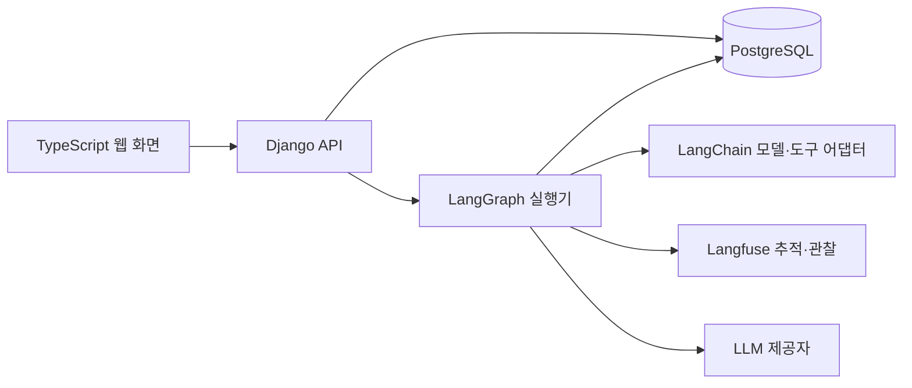

# jobMate MVP 기획서

> 이 초안은 [jobMate v1.0.1 개발 문서 세트](jobMate_v1.0.1/README.md)로 대체되었습니다. 최신 일정 자동화 정책은 Gmail에서 유효한 일정을 추출해 Calendar에 자동 등록하고, 이후 웹 푸시를 발송하며, 푸시 선택 시 원본 메일로 이동하는 것입니다.

| 항목 | 내용 |
|---|---|
| 문서 버전 | 0.1 |
| 기준일 | 2026-11-19 |
| 제품명 | jobMate |
| 제품 유형 | 기업 업무 자동화를 위한 멀티 에이전트 오케스트레이션 플랫폼 |
| 목표 사용자 | 반복 업무를 자동화하려는 중소·중견기업의 운영 담당자와 관리자 |
| 기술 기반 | Python, Django, PostgreSQL, LangChain, LangGraph, Langfuse, TypeScript |

## 1. 제품 개요

jobMate는 기업의 반복 업무를 워크플로로 등록하고, 각 업무 단계에 적합한 AI 에이전트를 배정해 실행·검토·승인하는 업무 자동화 플랫폼이다. 사용자는 업무 목표와 입력 자료를 제공하고, jobMate는 정해진 에이전트 흐름에 따라 결과물을 만든다. 외부로 나가는 메시지 발송, 데이터 변경, 결재 등 영향이 큰 동작은 사람이 승인한 뒤 수행한다.

장기 방향은 기업 전반의 업무 자동화다. MVP는 범위를 통제하고 효과를 검증하기 위해 문서 기반의 내부 업무 3종으로 시작한다: 회의록 정리 및 액션 아이템 추출, 문의 분류 및 답변 초안 작성, 주간 업무 보고서 초안 작성.

## 2. 문제와 목표

### 2.1 해결할 문제

- 반복적인 자료 읽기, 분류, 요약, 초안 작성에 직원 시간이 소모된다.
- 범용 챗봇은 여러 단계 업무의 담당 역할, 진행 상태, 승인 지점을 관리하기 어렵다.
- AI 결과 생성 과정과 사용 근거를 추적하기 어려워 기업 업무에 적용하기 부담스럽다.

### 2.2 MVP 목표

1. 관리자가 업무 템플릿을 선택하고 필요한 입력 항목을 설정할 수 있다.
2. 요청마다 업무 단계를 그래프로 실행하고, 단계별 전문 에이전트를 배정한다.
3. 실행 상태, 단계별 결과, 실패 원인과 토큰·비용 정보를 기록한다.
4. 지정된 단계에서 사람이 결과를 검토·수정·승인하거나 실행을 중단할 수 있다.
5. 파일 또는 텍스트 입력으로 업무를 실행하고 결과물을 내려받을 수 있다.

### 2.3 성공 지표

- 템플릿별 업무 완료율 및 사람의 재작업 비율
- 업무 1건당 절약된 처리 시간(초기 기준선과 파일럿 비교)
- 실행당 평균 대기 시간, LLM 사용량 및 추정 비용
- 승인 단계 반려율과 자동화 후 오류 신고 건수

초기 파일럿에서 기준선을 측정한 후 목표 수치를 정한다. 정확도와 비용은 모델 및 업무별로 분리해 관찰한다.

## 3. MVP 범위

### 포함

- 단일 조직 워크스페이스 및 사용자 로그인
- 역할: 관리자, 요청자, 승인자
- 템플릿 목록, 템플릿 선택, 실행 요청과 상태 조회
- 문서/텍스트 입력, 결과 미리보기 및 다운로드
- LangGraph 기반 순차·조건 분기 업무 흐름
- 단계별 에이전트 설정(역할 지침, 입력·출력 스키마, 허용 도구)
- 사람 승인 및 수정 단계
- 실행 이력, 단계별 로그, 오류·재시도 상태
- Langfuse를 통한 추적, 지연 시간, 토큰 및 비용 관찰

### MVP에서 제외

- 모든 부서·업무를 포괄하는 범용 자동화 빌더
- 결재·급여·회계·채용 등 고위험 업무의 무인 실행
- 기업 시스템 다수와의 양방향 커넥터, 이메일 자동 발송 및 외부 공개 동작
- 에이전트가 임의로 에이전트를 만들거나 권한을 확장하는 기능
- 멀티테넌트 과금, 마켓플레이스, 모바일 앱, SLA 보장

## 4. 초기 업무 템플릿

| 템플릿 | 에이전트 단계 | 결과 및 승인 |
|---|---|---|
| 회의록 정리 | 회의록 정리 에이전트 → 액션 아이템 추출 에이전트 → 품질 검토 에이전트 | 요약, 담당자·기한이 표시된 할 일 목록. 요청자가 확인 후 내보냄 |
| 문의 답변 초안 | 문의 분류 에이전트 → 사내 지식 검색/답변 초안 에이전트 → 정책 검토 에이전트 | 분류, 근거와 답변 초안. 담당자가 검토하며 발송은 MVP에서 하지 않음 |
| 주간 업무 보고서 | 자료 요약 에이전트 → 성과·이슈 분석 에이전트 → 보고서 작성 에이전트 → 검토 에이전트 | 근거 자료 링크가 포함된 보고서 초안. 작성자가 승인 후 다운로드 |

업무 템플릿은 에이전트의 역할과 연결을 미리 정의한다. MVP에서 사용자가 자유롭게 코드나 도구를 등록하지 못하게 해 실행 결과와 권한을 예측 가능하게 유지한다.

## 5. 사용자와 핵심 흐름

### 5.1 역할

- **관리자**: 사용자와 역할 관리, 템플릿 활성화, 에이전트 지침 및 실행 정책 관리
- **요청자**: 템플릿 선택, 입력 제출, 실행 상태·결과 확인
- **승인자**: 승인 요청 검토, 수정 의견 작성, 승인·반려·중단

한 사용자가 여러 역할을 가질 수 있으며 모든 권한은 서버에서 확인한다.

### 5.2 정상 흐름

1. 요청자가 템플릿을 선택하고 텍스트 또는 파일을 제출한다.
2. Django가 요청을 검증하고 실행 레코드를 생성한다.
3. LangGraph가 템플릿의 정의된 노드를 순서에 따라 실행한다.
4. 에이전트 결과와 사용량을 각 단계에 저장하고 실행 화면에 상태를 제공한다.
5. 승인 노드에 도달하면 실행을 일시 정지하고 승인자에게 검토 항목을 표시한다.
6. 승인되면 후속 노드를 실행하고 최종 결과를 저장한다. 반려되면 의견과 함께 요청자에게 반환한다.

### 5.3 실패·복구

- 일시적인 모델/API 오류는 제한된 횟수로 재시도하고, 실패 시 오류 상태와 재실행 가능한 단계를 기록한다.
- 사용자가 취소한 실행은 새 단계를 시작하지 않으며 이미 저장된 결과는 이력에 남긴다.
- 승인 대기 상태는 타임아웃으로 자동 승인하지 않는다.
- 입력이 불충분하거나 결과 검증에 실패하면 결과를 완성된 것으로 표시하지 않고 사용자 보완을 요청한다.

## 6. 시스템 구성

### 기술 책임

| 기술 | 책임 |
|---|---|
| Python | 백엔드 및 에이전트 실행 |
| Django | 인증·권한, 업무/실행 API, 관리자 기능, 데이터 검증 |
| PostgreSQL | 조직, 사용자, 템플릿, 실행, 단계 결과 및 승인 데이터 저장 |
| LangGraph | 명시적인 상태와 노드·분기를 갖는 업무 실행 흐름, 일시 정지·재개 |
| LangChain | 모델 호출, 프롬프트/출력 구조화, 승인된 도구 어댑터 |
| Langfuse | 추적, 프롬프트 버전 기록, 모델 지연·토큰·비용 관찰 |
| TypeScript | 업무 목록, 실행 상세, 입력 폼, 승인 및 결과 화면 |

MVP는 단일 Django 애플리케이션 안에 API와 실행 오케스트레이션을 두는 모듈형 모놀리스로 시작한다. 실행은 HTTP 요청 수명에 묶지 않고 백그라운드 작업으로 처리한다. 큐와 작업 실행기 선택은 배포 환경의 요구량에 맞춰 확정하되, 실행 상태와 재시도 정보는 PostgreSQL에 영속화한다.

## 7. 핵심 데이터 개념

- **Organization**: 조직 및 설정
- **User / Membership**: 사용자와 조직 내 역할
- **WorkflowTemplate**: 업무 입력 스키마, 활성 버전, 그래프 정의
- **AgentDefinition**: 역할 지침, 모델 설정 참조, 출력 스키마, 허용 도구 목록
- **WorkflowRun**: 요청자, 상태, 입력 참조, 시작/종료 시각, 결과 참조
- **StepRun**: 실행 단계, 상태, 재시도 수, 입력·출력 참조, 오류 코드
- **Approval**: 검토 대상, 승인자, 결정, 의견, 결정 시각
- **AuditEvent**: 권한 및 상태 변경의 행위자·대상·시각 기록

템플릿과 에이전트 설정은 버전을 고정해 실행 시점의 설정을 재현할 수 있게 한다. 비밀 키는 데이터베이스에 평문 저장하지 않는다. 원문 입력과 출력의 보관 기간은 파일럿 전에 조직 정책으로 결정하고 최소 권한으로 접근한다.

## 8. 기능 요구사항

| ID | 요구사항 | 완료 기준 |
|---|---|---|
| JM-AUTH-01 | 로그인 및 역할 권한 확인 | 비인가 사용자가 타인의 업무·결과를 조회하거나 승인할 수 없다 |
| JM-WF-01 | 템플릿 선택 및 입력 제출 | 입력 검증 오류가 필드별로 표시되고 정상 요청은 실행 이력을 만든다 |
| JM-RUN-01 | 백그라운드 실행과 상태 조회 | 대기/실행/승인 대기/완료/실패/취소 상태가 갱신된다 |
| JM-AGT-01 | 단계별 에이전트 실행 | 각 노드의 입력·출력 계약 및 실패가 기록된다 |
| JM-APR-01 | 승인·반려·취소 | 승인자와 결정이 감사 이력에 남고, 승인 전에는 후속 실행이 진행되지 않는다 |
| JM-OBS-01 | 실행 추적 | 실행과 단계가 상관관계 ID로 연결되며 모델 사용량과 지연을 조회할 수 있다 |
| JM-RES-01 | 결과 열람 및 내보내기 | 권한 있는 사용자만 최종 결과를 열람·다운로드한다 |
| JM-ADM-01 | 템플릿 및 에이전트 설정 관리 | 변경은 새 버전으로 기록되고 기존 실행 설정은 변하지 않는다 |

## 9. 안전·운영 원칙

- 모델 출력은 신뢰할 수 없는 입력으로 처리하고, 구조화 출력 검증을 통과한 뒤 사용한다.
- 도구는 템플릿에 등록된 허용 목록으로 제한하고 임의 셸·코드 실행을 제공하지 않는다.
- 외부로 영향을 주는 동작은 승인 단계가 명시된 경우에만 실행 가능하게 설계한다.
- 프롬프트 인젝션과 입력 문서 내 지시를 경계하고, 권한·정책은 모델 판단에 맡기지 않는다.
- 로그와 관찰 도구에 비밀번호, 토큰, 불필요한 개인정보 및 원문 문서를 기록하지 않는다.
- LLM 제공자에 입력 데이터가 전송되는 사실과 보관 정책을 사용자에게 알리고, 조직이 비활성화할 수 있도록 한다.
- 각 실행의 비용 상한, 단계별 타임아웃, 재시도 횟수를 설정한다.
- 사용자가 입력 자료를 삭제하거나 업무 기록의 보관 만료를 요청할 수 있는 정책을 파일럿 운영 전에 정한다.

## 10. 화면 범위

1. 로그인
2. 업무 템플릿 목록 및 템플릿 설명
3. 업무 입력·첨부 화면
4. 내 업무 목록(상태 필터 포함)
5. 실행 상세(단계 상태, 승인 요청, 오류 및 결과)
6. 승인함(승인·반려·의견)
7. 관리자 템플릿·에이전트 설정 화면

## 11. MVP 단계와 완료 조건

### 1단계: 기반

- Django 프로젝트, PostgreSQL 스키마, 사용자 역할과 API 계약 확정
- LangGraph 실행 상태와 Langfuse 추적 연결
- 한 개의 샘플 템플릿을 끝까지 실행

### 2단계: 업무 템플릿과 승인

- 초기 3개 템플릿 구성
- 실행 목록·상세·승인 화면 연결
- 실패, 재시도, 취소, 버전 고정 동작 구현

### 3단계: 파일럿 준비

- 대표 입력으로 업무 담당자가 결과를 검토
- 권한 격리, 프롬프트 인젝션, 오류 복구, 비용 상한 확인
- 실제 처리 시간과 재작업률을 측정하고 다음 범위를 결정

### MVP 완료 조건

- 세 템플릿 각각 정상 실행과 오류 복구가 관찰된다.
- 승인 전 실행이 멈추고, 승인/반려 결과와 담당자가 기록된다.
- 권한 없는 사용자의 타 조직·타 사용자 데이터 접근이 차단된다.
- Langfuse에서 실행 추적을 찾아 모델 사용량과 실패 단계를 확인할 수 있다.
- 파일럿 사용자가 입력부터 결과 확인까지 주요 흐름을 완료한다.

## 12. 주요 위험과 대응

| 위험 | 대응 |
|---|---|
| 업무 범위가 무한히 확장됨 | 템플릿 3종과 입력/출력 계약으로 MVP를 제한하고 파일럿 지표로 우선순위 결정 |
| 잘못된 생성 결과가 실제 업무에 반영됨 | 초안 중심으로 제공하고 중요한 결과는 사람 승인 후 사용 |
| 에이전트 간 책임과 실패 원인이 불명확함 | 단계별 입력·출력·상태·오류를 저장하고 실행 추적으로 연결 |
| 모델 비용 또는 지연이 커짐 | 단계·실행별 사용량 관찰, 상한 및 타임아웃, 필요한 경우에만 재시도 |
| 민감한 회사 자료가 노출됨 | 최소 권한, 로그 마스킹, 보관 정책, 제공자 전송 고지, 조직별 데이터 경계 적용 |
| 모델/프롬프트 변경으로 결과가 변함 | 템플릿·에이전트 버전 고정 및 대표 업무 검토 후 활성화 |

## 13. 미결정 사항

- 첫 파일럿 조직과 부서, 업무별 현행 처리 시간 및 기준 성공 지표
- 배포 방식과 운영 담당자, 모델 제공자 및 데이터 처리 조건
- 파일 업로드 형식·크기, 파일 저장 위치와 보관 기간
- 백그라운드 작업 큐/워커 선택과 동시 실행량
- 업무 템플릿별 승인 권한자와 결과 책임자
- Langfuse에 기록할 데이터 범위와 배포 위치
