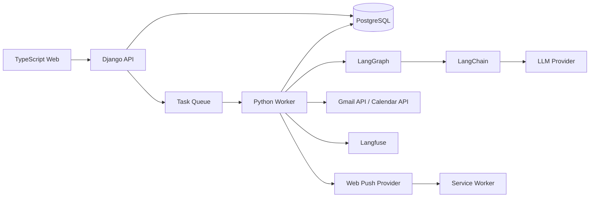

# jobMate 시스템 상세설계서

| 항목 | 값 |
|---|---|
| 문서 버전 | 1.0.1 |
| 기준일 | 2026-11-19 |
| 구현 기준 | Django 모듈형 모놀리스, PostgreSQL, 비동기 워커 |
| 관련 문서 | 기본기획서, 기능별 상세설계서, API 설계서, DB 설계서 |

## 문서 이력

| 버전 | 기준일 | 수정 내용 |
|---|---|---|
| 1.0.0 | 2026-11-19 | 최초 작성, 6계층 하네스 런타임 원칙 반영 |
| 1.0.1 | 2026-11-27 | docs/harness/01·04 내용을 부록 A·B로 통합 |

## 1. 아키텍처



## 2. 모듈 책임

| 모듈 | 책임 |
|---|---|
| identity | 사용자, 조직 멤버십, 역할, 세션 |
| workflow | 템플릿, 버전, 입력 검증, 실행 생성 |
| orchestration | LangGraph 정의·상태 전이·재개, 단계 결과 |
| integrations.google | OAuth 연결, Gmail 검색, Calendar 이벤트 생성 |
| notifications | 푸시 구독, 예약·전송·재시도·클릭 경로 |
| observability | 실행 ID, Langfuse trace 연계, 비용·오류 지표 |
| audit | 권한·연결·자동 등록·승인 이력 |

## 3. Gmail 일정 자동화 흐름

1. 연결된 계정별 Gmail 감지 작업을 스케줄링한다. 초기 구현은 주기 검색(polling)으로 시작한다.
2. 검색은 설정된 시간 범위와 처리 이력 이후의 메일로 제한한다.
3. 메일 파서와 일정 추출 에이전트는 구조화된 후보를 반환한다. 모델 출력은 스키마·날짜·시간대 검증을 통과해야 한다.
4. 정책 검증기는 일정 확정성, 반복 여부, 참석자, 원본 ID 및 기존 처리 여부를 확인한다.
5. 유효한 신규 일정은 Calendar API로 생성한다. idempotency key 및 DB unique constraint로 중복을 방지한다.
6. 이벤트 ID를 저장한 뒤 알림 작업을 생성한다. 푸시 payload의 URL은 원본 Gmail 메시지 링크다.
7. 모호한 후보는 `needs_review`, 인증 철회는 `connection_error`, 일시 오류는 재시도 상태로 남긴다.

Google API 성공 후 DB 저장이 실패할 수 있으므로, 재처리 시 Calendar 이벤트 ID/extendedProperties 또는 저장한 idempotency key를 조회해 중복을 방지한다. 일정 삭제·수정 동기화는 MVP 범위에 포함하지 않는다.

## 4. 실행 상태

`queued → running → waiting_review | completed | failed | cancelled`

일정 자동화 단계 상태는 `discovered → extracted → validated → calendar_created → notification_queued → notified`를 사용한다. `needs_review`, `duplicate`, `connection_error`, `retry_wait`는 보조 상태다.

## 5. 신뢰성·보안

- API 요청은 실행 레코드를 만든 뒤 큐에 전달하며, 큐 중복 전달을 고려해 작업을 멱등하게 만든다.
- 단계별 timeout, 제한 재시도, exponential backoff 및 dead-letter 상태를 둔다.
- OAuth access/refresh token은 KMS 또는 애플리케이션 암호화 키로 암호화한다.
- Google API 호출과 Calendar 생성 권한은 통합 모듈에서만 수행한다.
- 서비스 워커는 알림 클릭을 검증된 Gmail URL 또는 정해진 도메인의 링크로만 이동시킨다.
- Langfuse에는 trace ID, 단계, 모델, 사용량, 오류 코드를 보내고 메일 본문 및 토큰은 마스킹한다.

## 6. 운영 관찰

필수 지표: 큐 대기 시간, 실행 소요 시간, Gmail API 오류율, 추출 실패율, Calendar 생성·중복률, 푸시 전송률, 워커 재시작 수, 토큰·비용. 알림 실패는 일정 생성을 롤백하지 않고 재시도한다.

## 7. 하네스 런타임 계약

| 계층 | 런타임 책임 | 구현 기준 |
|---|---|---|
| 가이드 | 템플릿/에이전트 버전과 실행 지시 고정 | workflow version과 prompt/config hash를 run에 저장 |
| 센서 | 산출물·권한·외부 효과의 결정적 검증 | schema validator, timezone validator, RBAC, idempotency constraint |
| 루프 | 상태 있는 단계 실행 | LangGraph checkpoint, 최대 재시도·시간·token/tool budget |
| 메모리 | 중단 후 복구 | PostgreSQL에 run checkpoint와 outbox 저장, 재개 cursor 영속화 |
| 권한·예산 | tool capability enforcement | 각 실행에 연결 사용자와 허용 scope를 묶고 서버 통합 계층에서 재검증 |
| 관찰가능성 | 추적·비용·운영 경보 | trace ID, step ID, prompt/config version, tool event, usage, 결과 ID 저장 |

LLM은 도구 호출 의도를 제안할 수 있지만 실행 허용 여부는 서버 정책이 결정한다. LangGraph checkpoint는 실행 메모리이며, 감사 기록과 업무 원장은 PostgreSQL 도메인 테이블을 기준으로 한다. Langfuse에 메일 본문/토큰을 보내지 않는다.

### 7.1 Gmail·Calendar 작업의 센서 순서

`mail access scope → 입력 크기/HTML 정리 → 일정 구조화 출력 검증 → 날짜·timezone·종료시각 검증 → 신뢰/모호성 정책 → 조직·연결 권한 → 멱등 키 확보 → Calendar write → event ID 확인 → DB commit/outbox → push enqueue`

어느 센서라도 실패하면 그 뒤의 부작용 단계는 실행하지 않는다. Calendar 생성 응답이 불명확한 경우에는 marker로 이벤트 존재를 확인하기 전 재생성을 시도하지 않는다.

### 7.2 정지와 복구

재시도·시간·호출·비용 상한에 도달하거나 외부 쓰기 급증, 반복 오류, 권한 이상이 발생하면 해당 실행 또는 연결의 신규 외부 쓰기를 일시 중단한다. checkpoint와 미완료 작업을 보존하고, 운영자 또는 사용자가 확인한 뒤 재개한다. 자동 재개는 외부 부작용 중복이 없음을 검증할 수 있을 때만 허용한다.

## 부록 A. 하네스 MVP 개발 기준 (구 docs/harness/01)

> 원본: docs/harness/01_하네스_MVP_개발문서.md (문서 버전 0.2, 기준일 2026-11-19). 하네스 문서는 본 문서로 통합되었으며 docs/harness/는 폐기됐다.

### 0. 범위 결정 사항

- **제공층은 FastAPI로 시작한다.** 상용 단계에서는 Django(인증·조직 권한·관리자 기능)로 전환한다.
  도메인 계층(`engine/`, `workflows/`, `models/`, `store/`, `sensors/`, `llm/`, `tools/`, `adapters/`)은
  HTTP 프레임워크에 의존하지 않으며, 전환 시 영향 범위는 `api/`와 `cli.py`로 한정된다.
- **영속 저장소는 SQLite(WAL)로 시작한다.** `store/db.py`가 유일한 접근 지점이며,
  상용 전환 시 PostgreSQL store 구현체 교체로 대응한다.
- **LLM은 OpenAI 호환 chat/completions(httpx)로 호출한다.** 구조화 출력은 프롬프트 JSON 지시 +
  Pydantic 검증(센서)으로 수행한다. 테스트는 `FakeLLM`으로 결정적으로 검증한다.
- **모델 라우팅은 2단계다.** 작업 중요도 기본 티어(`JOBMATE_DEFAULT_MODEL`=경량,
  `JOBMATE_IMPORTANT_MODEL`=강한)와 역할별 서브모델 오버라이드(`JOBMATE_ROLE_MODELS`,
  JSON `{"reviewer": "important"}` 형태)를 `Settings.model_for()`가 해석한다.
  각 `ModelConfig`는 model/base_url/api_key_env/temperature/max_tokens를 가진다.
- **implementer는 변경 제안만 출력한다.** unified diff 텍스트(`ChangeProposal`)를 산출할 뿐
  실제 파일 적용은 하지 않는다(후속 샌드박스 연동). 자동 검사는 baseline 명령 중심이다.
- **Web Push·OAuth 동의 흐름·Gmail history cursor·문서 템플릿은 범위 외**(spec Out of Scope 참조).

### 1. 목표와 완료 조건

head가 배정·분기만 담당하는 멀티 에이전트 실행 엔진을 만들고, 그 위에
개발팀 리뷰 파이프라인(dev_review)과 Gmail→Calendar 자동화(gmail_calendar)를 올린다.
모델이 "완료했다"고 말하는 것이 아니라 DB 레코드·외부 ID·검사 결과가 완료 증거다.

### 2. 아키텍처

```
FastAPI (api/app.py) / CLI (cli.py)
   │  runs 생성·조회·승인 / gmail 자동화 토글·폴링
   ▼
WorkflowRunner (engine/runner.py) — WorkflowSpec을 LangGraph StateGraph로 컴파일
   │  stage node: llm(FunctionContext 경유) / function / human(interrupt)
   ▼
6계층 하네스
  가이드   guide/prompts/*.md (버전 주석) + AgentSpec
  센서     sensors/ — verdict 강등·스키마·diff·시크릿·URL·timezone 검증
  루프     budgets — 토큰/도구/시간/비용 + 리뷰2·전체3·수정5 상한
  메모리   store/db.py SQLite(WAL) + LangGraph SqliteSaver checkpoint
  권한     tools/executor.py allowlist + adapters Protocol 분리
  관찰     stage_runs/audit_events, run_id·trace_id 추적
   │
LLMClient Protocol (OpenAICompatLLM / FakeLLM)
GmailClient·CalendarClient·Notifier Protocol (Fake*/real 후속)
```

#### 2.1 계층별 구현 매핑

| 하네스 계층 | 구현 | 위치 |
|---|---|---|
| 가이드 | `WorkflowSpec`/`AgentSpec`/`ModelConfig`(버전·프롬프트·출력 스키마·모델·도구 allowlist) + `guide/prompts/*.md` | `models/spec.py`, `guide/` |
| 센서 | verdict 스키마 검증·approve+blocker 강등·confidence 필터, diff 형식/git apply --check, 시크릿 패턴, Gmail URL 허용목록, 일정 검증(tz/DST/모호/반복) | `sensors/` |
| 에이전틱 루프 | LangGraph StateGraph, 노드 재시도(스키마 실패 자기루프), 시간·토큰·도구·비용 예산, 루프 상한, 소진 시 안전 정지 | `engine/runner.py`, `budgets.py` |
| 메모리 | SQLite: runs, stage_runs, approvals, audit_events, event_links, notifications, automation_state + SqliteSaver checkpoint | `store/db.py` |
| 권한·예산 | `ToolExecutor`가 AgentSpec.tools allowlist를 서버에서 강제(리뷰어=read_diff, QA=read_diff+run_tests). Gmail 읽기/Calendar 쓰기/Notifier는 별도 Protocol | `tools/`, `adapters/` |
| 관찰가능성 | stage_runs(입출력·시도·사용량), audit_events(판정·분기·승인·외부쓰기), trace_id. Langfuse는 연결 지점만 | `store/db.py`, `engine/runner.py` |

#### 2.2 dev_review 상태 흐름

```
analysis → implement → auto_checks ──FAIL──→ implement (fix 루프 ≤5)
                │ PASS
                ▼
           security ──request_changes──→ implement (review 루프 ≤2)
                │ approve
                ▼
           code_review ──request_changes──→ implement
                │ approve
                ▼
              qa ──fail──→ implement / ──needs_human──→ finalize
                │ pass
                ▼
           approval (human interrupt) ──approve/reject──→ finalize
```

- 상한: 리뷰성 단계 회귀 `max_review_rounds=2`, 구현 총 실행 `max_implement_rounds=3`,
  자동검사 실패 회귀 `max_fix_rounds=5`. 초과 시 `needs_human`, 예산 소진 시 `budget_exhausted`.
- `finalize`는 run.status를 completed/rejected/failed/needs_human/budget_exhausted로 확정하고
  PR 요약(What changed/Blast radius/Verification Results/Tests 구조)을 run.metadata에 저장한다.

#### 2.3 gmail_calendar 상태 흐름

메시지 단위 run(`gmail_message_id` 컨텍스트). 동일 엔진의 stage/run/audit 구조를 사용한다.

```
extract(LLM) → validate(결정적) → register(멱등) → notify
                    │ needs_review/invalid → finalize
                    │ created/recovered/duplicate → notify
                    │ duplicate_pending/retry_wait → finalize
```

- 멱등키: `sha256(connection_id:message_id)[:32]` → `event_links.idempotency_key` UNIQUE.
- `reserve_link`가 pending 행을 원자적으로 확보 — 중복이면 marker 조회로 복구하거나 duplicate.
- Calendar 타임아웃(결과 불명) 시 `find_by_marker` 조회 후에만 채택/재시도 — 재생성 금지.
- 알림 실패는 Calendar 이벤트를 롤백하지 않고 `notification_queued`로 남긴다.
- `source_url`은 서버가 `https://mail.google.com/mail/u/0/#all/{id}`로만 생성,
  `is_safe_source_url`이 https+mail.google.com을 재검증한다.

### 3. 모듈 구조

```
src/jobmate/
  config.py            Settings: DB 경로, 모델 티어, 역할별 오버라이드, 예산, 검사 명령
  models/              enums, spec(Workflow/Agent/Model), outputs(LLM 스키마), records(DB)
  store/db.py          SQLite Store — runs/stage_runs/approvals/audit/event_links/notifications
  sensors/             verdicts, secrets, diffcheck, gmail_url, event_validation
  llm/client.py        LLMClient Protocol, OpenAICompatLLM, FakeLLM, extract_json
  guide/               loader.py + prompts/{analysis,implementer,security_review,
                       code_review,qa,event_extract}.md (# vX.Y 버전 주석)
  tools/executor.py    ToolExecutor — allowlist 강제, 경로 제한, 결과 크기 제한
  budgets.py           BudgetTracker(참조 구현; runner는 state 누적치로 동일 판정)
  engine/
    spec 해석은 models/spec.py, registry.py(Workflow/Agent 등록),
    state.py(HarnessState — JSON 직렬화 가능 필드만),
    runner.py(그래프 빌드·노드·분기·interrupt·finalize),
    functions.py(auto_checks/gmail_* function 단계), schemas.py(출력 스키마 맵)
  workflows/           dev_review.py, gmail_calendar.py, registry_builder.py
  adapters/            protocols.py(Gmail/Calendar/Notifier), fakes.py
  api/app.py           FastAPI 앱 + 라우터 + 정적 페이지 마운트
  api/static/index.html 상태 페이지(미니멀/스위스)
  cli.py               jobmate run/status/approve/workflows
tests/{unit,integration,api}/
```

### 4. 핵심 설계 결정

#### 4.1 리뷰·보안·QA 역할 분리 (gstack 참조)

- **코드 리뷰**: "이 코드를 어떻게 더 좋게 할까?" — diff+명세+검사 결과 독립 입력,
  읽기 전용, gstack findings 스키마(severity/confidence/path/line/category/summary/fix/
  fingerprint/specialist). `NO FINDINGS`는 정상 결과. confidence 게이트(very_low 제외).
- **보안 검토**: 증거 우선 — attack_surface/trust_boundary/evidence 필드로
  공격자·경계·영향을 분리 판정.
- **QA**: "이 결과를 내보내도 되는가?" — 검사 결과+findings 해소+요구사항 종합,
  증거 불충분 시 pass 금지(pass/fail/needs_human).
- **결정적 강등**: approve + blocker/major(confidence≠very_low) finding → request_changes
  (`sensors/verdicts.downgrade_approve`). 깨진 JSON·스키마 위반은 재시도 후 실패 —
  approve로 해석하지 않는다.

#### 4.2 멱등성 (gmail_calendar)

`reserve_link` UNIQUE 제약 + marker 조회 복구 + Calendar event ID 선저장 후 알림.
상세는 2.3절.

#### 4.3 사람 승인

LangGraph `interrupt` — `waiting_approval` 상태에서 프로세스가 멈추고,
`POST /api/v1/runs/{id}/approve`(또는 CLI resume)가 `Command(resume=...)`로 재개한다.
SqliteSaver checkpoint(thread_id=run_id)로 완료 stage는 재실행되지 않는다.

#### 4.4 예산과 안전 정지

state에 누적되는 tokens_in/out·tool_calls·cost_usd·started_at과
review/implement/fix_rounds를 매 LLM 단계 진입 전 검사한다.
소진·상한 초과 시 LLM 호출 없이 `budget_exhausted`/`needs_human`으로 finalize.

#### 4.5 관찰가능성·비밀 관리

- 모든 stage 입출력·판정·분기·승인·외부 쓰기를 run_id/trace_id로 추적.
- audit detail에는 본문·토큰·비밀값을 넣지 않는다(호출자 책임 + 테스트로 검증).
- `api_key_env`는 환경변수 이름만 저장한다.

### 5. FastAPI 제공층 (임시)

상세는 [02_API_명세.md](06_API_설계서_v1.0.1.md). 요약:

| Method | Path | 목적 |
|---|---|---|
| GET | `/` | 상태 페이지(정적 HTML) |
| GET | `/api/v1/health` | 상태 확인 |
| GET | `/api/v1/workflows` | 등록 워크플로 목록 |
| POST | `/api/v1/runs` | run 생성·백그라운드 실행(202) |
| GET | `/api/v1/runs`, `/api/v1/runs/{id}` | run 목록/상세(단계·승인·audit 포함) |
| POST | `/api/v1/runs/{id}/approve` | 승인/거부(resume) |
| GET | `/api/v1/notifications` | 알림 목록 |
| GET | `/api/v1/event-links` | 이벤트 링크 이력 |
| GET/POST | `/api/v1/gmail-calendar[/toggle|/poll]` | 자동화 상태·토글·수동 폴링 |

인증·조직 권한은 Django 전환 시 추가한다. 그 전까지는 로컬 바인딩 전제의 MVP API다.

### 6. 비기능·보안

- 외부 호출 타임아웃 필수(OpenAICompatLLM timeout_seconds, subprocess timeout).
- 도구 allowlist는 `AgentSpec.tools` + `ToolExecutor` 이중 강제.
- 프롬프트 인젝션: 메일 본문·작업 지시는 "데이터"로만 취급 — 프롬프트에 명시,
  도구 권한은 allowlist로만 결정(모델 출력이 권한을 바꾸지 못함).
- `source_url` 허용 호스트 재검증, 알림 본문에 메일 본문 미포함.

### 7. 후속 마일스톤 (범위 외)

- Django 전환: 인증·조직·RBAC·관리자 화면, OAuth 동의 흐름, Web Push(SW/VAPID)
- implementer 실제 코드 적용(샌드박스/worktree), PR 자동 생성
- PostgreSQL 이전, Langfuse 실험·회귀 게이트, Gmail history cursor 증분 동기화
- 문서 업무 템플릿 3종, 다중 스페셜리스트 병렬 서브에이전트
- real Gmail/Calendar/Notifier 어댑터(googleapiclient) — Protocol은 준비됨

### 8. 참고 구현

- `calendar-agent`: googleapiclient 클라이언트, 멱등 등록, SQLite WAL 패턴
- `skillRadar`: OpenAI 호환 호출·재시도, LangGraph + SqliteSaver, pydantic-settings
- `gstack`(github.com/garrytan/gstack): 리뷰 스페셜리스트·findings 스키마·confidence 게이트,
  CSO 증거 우선 보안 검토, verify(저장소 선언 검사만 실행), ship(PR 요약 구조)
- `ui-ux-pro-max`: 상태 페이지 디자인 토큰(미니멀/스위스, 단일 액센트)

## 부록 B. 적대적 코드 리뷰 이력 (구 docs/harness/04)

> 원본: docs/harness/04_적대적_코드리뷰.md (문서 버전 0.1, 기준일 2026-11-19). 하네스 문서는 본 문서로 통합되었으며 docs/harness/는 폐기됐다.

### 1. 확정 Findings 및 조치

#### BLOCKER

| # | 위치 | 내용 | evidence | 조치 |
|---|---|---|---|---|
| B-1 | `engine/state.py` | `stage_outputs`/`stage_attempts`에 merge reducer 없음 — LangGraph는 reducer 없는 dict 필드를 통째로 교체 → 이전 단계 출력 유실, implement 피드백·PR 요약이 빈 값이 됨 | 상태머신 렌즈: 노드 반환 `{stage.key: out}`이 필드 전체를 덮어씀. 테스트로 재현 확인 | `Annotated[..., _merge_dicts]` reducer 추가. 회귀 테스트 `test_stage_outputs_accumulate_for_pr_summary` 추가 |
| B-2 | `engine/runner.py` `_route` | `auto_checks.passed`가 bool인데 분기 키가 `"true"/"false"` 문자열 — `str(True)="True"`로 매칭 실패, 시퀀셜 진행으로 자동검사 FAIL이 implement로 회귀하지 않음 | 상태머신 렌즈: FAIL 경로가 security로 새어나감 | bool→소문자 문자열 정규화. 회귀 테스트 `test_auto_checks_failure_loops_to_implement` 추가 |

#### MAJOR

| # | 위치 | 내용 | evidence | 조치 |
|---|---|---|---|---|
| M-1 | `tests/integration/helpers.py` `scripted_llm` | script 값이 단일 모델 인스턴스면 `list(model)`이 pydantic `__iter__`로 (field,value) 튜플 리스트가 되어 쓰레기 출력 생성 — 기존 테스트가 분기 버그(B-2)에 가려져 통과했음 | 테스트 렌즈: fixture 자체가 잘못된 계약 | 값 정규화(단일→`[v]`). 유효 diff 픽스처(`VALID_DIFF`)로 교체 — `git apply --check` 실검증 통과 확인 |
| M-2 | `engine/functions.py` `gmail_register` | 재시도 시 기존 pending 링크의 marker 복구 경로 부재 — 타임아웃 후 재처리가 `duplicate_pending`으로만 끝나 notify 도달 불가 | 멱등성 렌즈: SC-004/복구 시나리오 실패 재현 | 기존 링크 분기에 `find_by_marker` 복구 추가. `test_calendar_timeout_recovers_via_marker` 통과 |
| M-3 | `engine/runner.py` `_run_human_stage` | interrupt 재개 시 노드가 처음부터 재실행되어 approval stage_run이 중복 생성(RUNNING 고아 행) | 상태머신 렌즈: resume 후 stage_runs에 (1,RUNNING)+(1,SUCCEEDED) 2행 | 기존 RUNNING stage_run 재사용. 재현 확인으로 1행 succeeded |

#### MINOR

| # | 위치 | 내용 | 조치 |
|---|---|---|---|
| m-1 | `engine/runner.py` | qa `decision="fail"`은 `request_changes` 카운터(review_rounds)에 미포함 — implement_rounds=3이 사실상 상한 역할 | 구현 라운드 상한이 전체를 bound하므로 허용. 문서에 명시 |
| m-2 | `llm/client.py` | `response_format=json_object`가 일부 OpenAI호환 엔드포인트(Gemini)에서 미지원 가능 | fake 경로는 무관, real 어댑터는 상용 전환 시 검증 필요로 기록 |
| m-3 | `api/app.py` | run 실행이 `threading.Thread` 데몬 — 프로세스 재시작 시 running 상태 run은 재개되지 않음(checkpoint는 있으나 스케줄러 없음) | MVP 한계 명시. Django 전환 시 task queue |
| m-4 | `sensors/gmail_url.py` | message_id 검증식이 복합 조건으로 가독성 낮음 | 동작은 정확, 가독성만 — 후속 정리 |

### 2. 검토했으나 finding 아님 (기각/가설)

- **감사 로그 비밀 누출**: audit detail은 severity/decision/summary(300자) 수준만 기록,
  메일 본문·토큰 경로 없음 — `test_audit_redaction_safe` + 코드 리뷰로 확인.
- **LLM 실패 무한 재시도**: `__retry__` 자기루프는 `agent.max_attempts` 이후
  `escalate=failed`로 종료 — bounded 확인.
- **Store 동시성**: `threading.Lock` + 단일 연결, 중첩 tx 없음(audit은 tx 블록 밖 호출) — 교착 없음 확인.
- **interrupt 재개 데이터**: `Command(resume=...)` 값이 dict가 아니면 예외 → API 500.
  승인 외 입력 경로가 없어 실위험 낮음 — 방어 코드로 `(decision or {})` 처리됨.

### 3. 리뷰 방식 메모 (gstack 대응)

- 자동 검사(테스트·린트·타입)가 모델 리뷰보다 먼저 — 깨진 상태에서 LLM 리뷰 비용 없음.
- `NO FINDINGS`는 정상 결과로 인정(findings=[] + approve).
- confidence 게이트: very_low finding은 필터링, low는 기록만.
- 보안 finding의 경로/라인 상세는 공개 PR 요약에서 제외 — `_audit_detail`이
  count/severity/summary 수준으로 제한.
- 리뷰어 입력은 diff+명세+검사 결과 — 구현 대화 컨텍스트 비노출.

### 4. QA 판정

| 항목 | 결과 |
|---|---|
| 자동 검사 | pytest 53 passed, ruff clean, mypy clean |
| 스펙 커버리지 | FR-001~019 중 MVP 범위 전부 대응(실계정/실제 적용은 Out of Scope) |
| 리뷰 해소 | blocker/major 전부 수정 + 회귀 테스트 |
| 잔여 리스크 | m-1~m-4 (문서화된 MVP 한계), real 어댑터 미검증 |
| **QA 판정** | **pass** (MVP 범위 내) |
